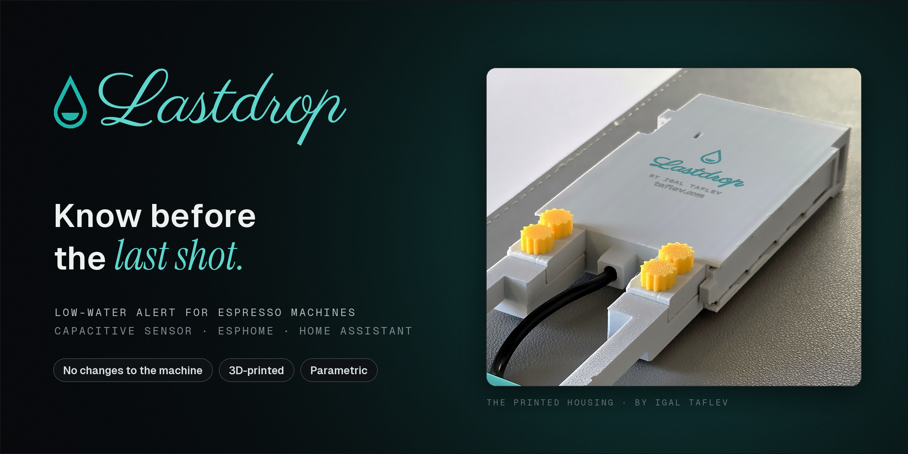
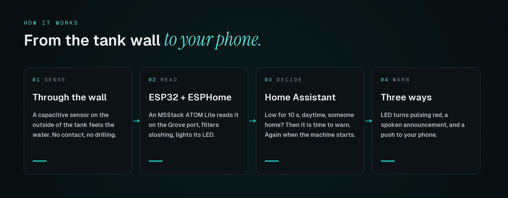
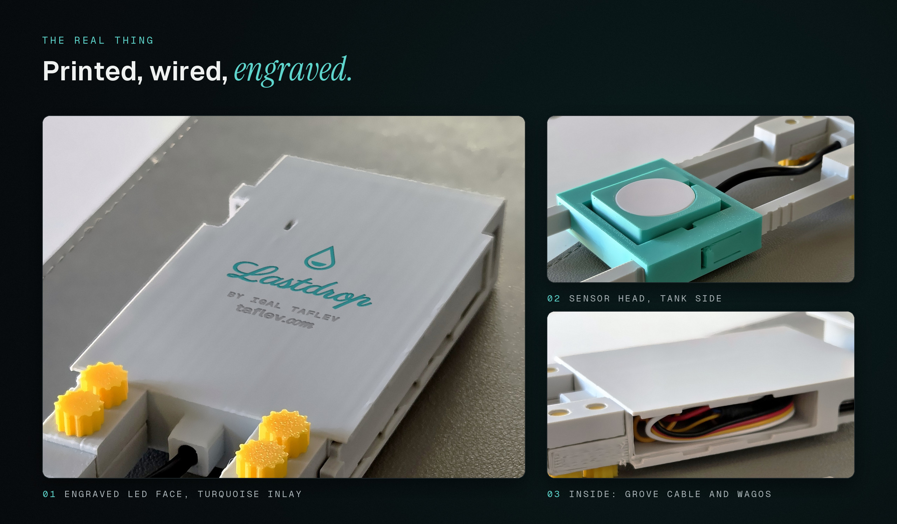
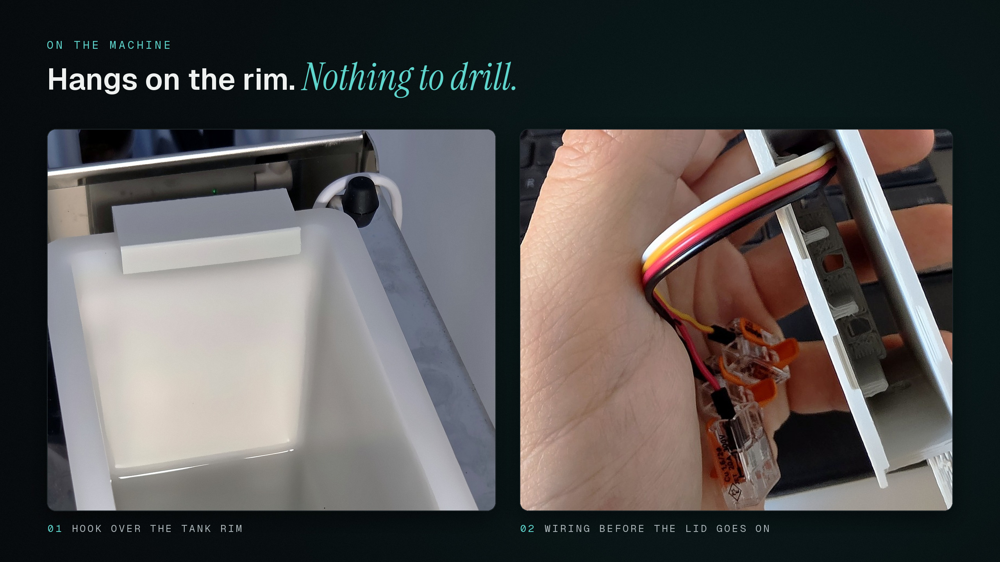
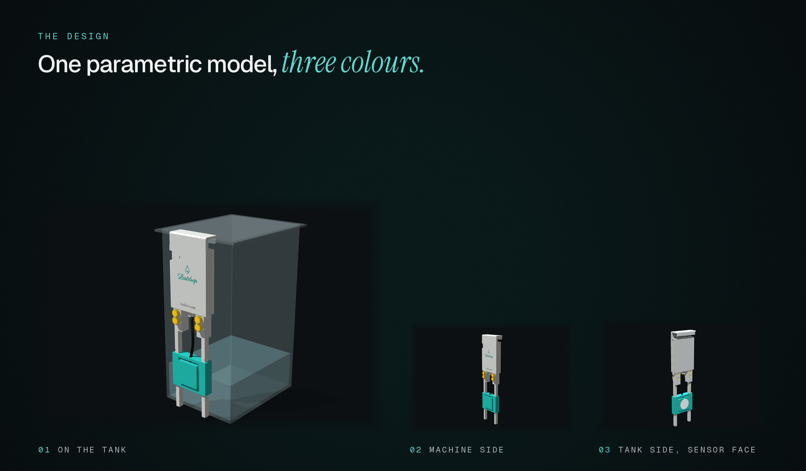
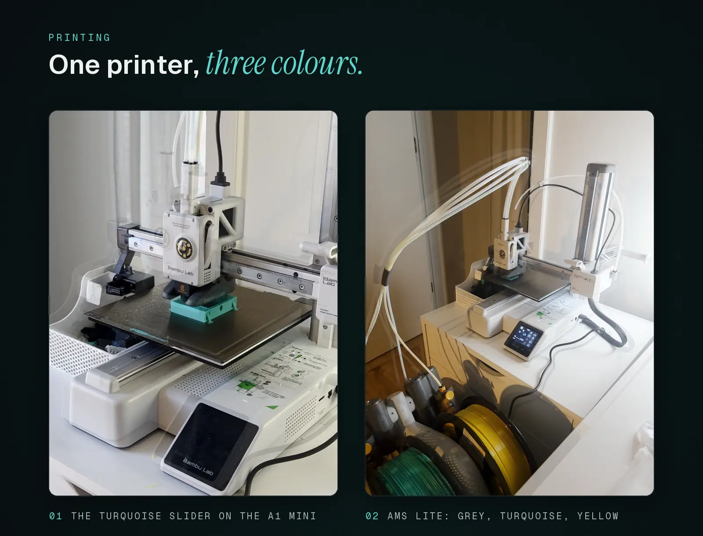

<p align="center">
  
</p>

<p align="center"></p>

Many espresso machines only stop when the tank is already empty, in the middle of a shot. Lastdrop warns you while
there are still two or three shots left. A sensor on the outside of the tank feels the water through the plastic,
and a small ESP32 in a 3D-printed housing tells Home Assistant. Nothing is opened, drilled or wired into the machine.

Built for an **ECM Classika PID**. It works on any machine with a plastic or glass tank you can reach from the
outside, and the housing is parametric, so it can be fitted to another tank.









## At a glance

| | |
| --- | --- |
| **Sensor** | XKC-Y25-NPN capacitive level sensor, flat against the outside of the tank |
| **Controller** | M5Stack ATOM Lite (ESP32) on ESPHome, with its LED as the status light |
| **Alerts** | Home Assistant: LED, spoken announcement, push to the phone; daytime only, only when someone is home |
| **Housing** | 8 printed part types, no glue, no bought screws; hangs on the tank rim |
| **Print** | Bambu Lab A1 mini + AMS lite, PETG in grey, turquoise and yellow, about 10 h 30 in total |
| **Adjust** | Sensor height 30 to 90 mm from the tank bottom, in 5 mm clicks |
| **Status** | Working on the ECM Classika PID it was built for |

## Build it

### 1. Parts

| Part | Qty | Link |
| --- | --- | --- |
| M5Stack ATOM Lite (ESP32) | 1 | [M5Stack shop](https://shop.m5stack.com/products/atom-lite-esp32-development-kit) · [docs](https://docs.m5stack.com/en/core/ATOM%20Lite) |
| M5Stack Grove2Dupont cable, 20 cm | 1 | [M5Stack shop](https://shop.m5stack.com/products/grove2dupont-conversion-cable-20cm-5pairs) |
| XKC-Y25-NPN liquid level sensor, 5 to 12 V (a spare is handy) | 1 | [Keyestudio](https://keyestudio.com/products/xkc-y25-5-12v-npn-output-interface-non-contact-adjustable-water-level-sensor) · [AliExpress](https://www.aliexpress.com/w/wholesale-XKC%2DY25%2DNPN.html) |
| WAGO 221-412 lever connector | 3 | [WAGO](https://www.wago.com/ca-en/installation-terminal-blocks-and-connectors/compact-splicing-connector/p/221-412) |
| USB-C cable long enough to leave the machine, and a 5 V USB power supply | 1 | any |
| Wire stripper for 20 to 30 AWG | tool | [Klein Tools 11057](https://www.kleintools.com/product/11057) |
| PETG: grey about 110 g, turquoise about 45 g, yellow about 3 g | | [Bambu Lab PETG HF](https://us.store.bambulab.com/products/petg-hf) |

### 2. Wiring

<p align="center"></p>

| Sensor | Grove | ATOM Lite |
| --- | --- | --- |
| brown | red | 5 V |
| blue | black | GND |
| yellow | yellow | GPIO26, signal |
| | white | not used, insulate it |

Cut the Dupont ends off and join each pair in a WAGO. Wire colours vary between sellers, so check the product page.

### 3. Firmware

1. Copy [`firmware/secrets.yaml.example`](firmware/secrets.yaml.example) to `secrets.yaml` and fill in your Wi-Fi,
   an API key, an OTA password and a password for the fallback hotspot. Never commit `secrets.yaml`.
2. Flash [`firmware/lastdrop.yaml`](firmware/lastdrop.yaml) once over USB from the ESPHome dashboard. Later updates go over Wi-Fi.
3. Adopt the new device in Home Assistant.

It exposes `binary_sensor.lastdrop_water_ok`, the status LED and the ATOM's button. The signal must be wet for 2 s to
count as OK and dry for 10 s to count as low, so sloshing never triggers it. If the LED is green with an empty tank,
set `inverted: false` on GPIO26.

### 4. Home Assistant

Paste [`home-assistant/lastdrop-low-water-automation.yaml`](home-assistant/lastdrop-low-water-automation.yaml) as a new
automation in YAML mode and change the lines marked `CHANGE`: your phone, text-to-speech engine, speaker and,
optionally, the smart plug of the machine (to warn again when it is switched on with a low tank).

### 5. Print

Open [`lastdrop_housing_A1mini_PETG_AMS_4plates.3mf`](3d/housing/print/lastdrop_housing_A1mini_PETG_AMS_4plates.3mf)
in Bambu Studio. Every setting is inside. AMS lite: **grey in slot 1, turquoise in slot 2, yellow in slot 3**.

| Plate | Parts | Colour | Time |
| --- | --- | --- | --- |
| 1 | sensor head and slider: print first, it tests the fits | turquoise | 1 h 10 |
| 2 | four thumb screws | yellow | 25 min |
| 3 | rails, lid, door, ATOM key | grey | 1 h 20 |
| 4 | top frame with the inlaid logo | grey + turquoise | 7 h 40 |



- **No AMS?** Plates 1 to 3 use one colour each. On plate 4, set the logo part to grey: the same engraving, in 2 h 20.
- **PETG, not PLA:** the housing sits next to the boiler. 0.2 mm layers, 3 walls, 25 % gyroid, tree supports from the
  plate only, Textured PEI.
- **The top frame stands on its LED face edge** so the box walls need almost no supports. The colour changes are what
  make it long; the purge goes into the hidden infill.
- **Printed threads:** turn the M6 thumb screws in gently the first time.
- Other slicers: [every part as an STL](3d/housing/print), already oriented (the screw is printed four times).

### 6. Assemble and hang

**[Step-by-step assembly guide, animated →](docs/ASSEMBLY.md)** Every step as a short 3D animation, with a close-up of the WAGO wiring, the tools, and what to check.

1. Push the sensor into the head from the front, narrow end first, until the wide face is flush.
2. Run its cable up through the slider's ring and into the floor hole of the box.
3. Join the wires in the WAGOs and press each one into its track, wire entries toward the door.
4. Plug the Grove cable into the ATOM, set it at the top with its LED behind the slot, and add the ATOM key behind it.
5. Screw the rails to the frame, click the slider in at the height you want, and clip the head on.
6. Slide the lid and the door on (they lift off after an 8 mm slide, no tools), hang the frame on the tank, and run the USB-C cable out of the back of the machine to a 5 V supply.

Set the height a little above the level at which your machine stops: the alert fires when the water drops below the sensor.

## Fit it to your tank

The housing is one [CadQuery](https://cadquery.readthedocs.io) model, [`3d/housing/build.py`](3d/housing/build.py),
with every size as a named constant at the top. Measure your tank's rim, wall, the room above the rim and the gap to
the machine wall, change the constants, then rebuild and check:

```bash
cd 3d && python -m venv .venv
.venv/bin/pip install cadquery trimesh manifold3d numpy shapely fonttools networkx lxml
cd housing
./run_all.sh            # model, threads, print orientation, Bambu Studio files
python verify_all.py    # 31 checks: fits, cable paths, lid and door, USB plug
python check_install.py # hangs the frame on the rim and checks the path
```

The engraving is drawn from the font files in [`3d/fonts`](3d/fonts) (SIL OFL), with every stroke kept at least
0.5 mm wide for a 0.4 mm nozzle.

## Repository

```
firmware/          ESPHome config and a secrets example
home-assistant/    the low-water automation
3d/housing/        the CadQuery model, print pipeline, checks and print files
3d/fonts/          the fonts of the engraving
docs/              assembly guide, images, panels, printing and step clips
```

## About

Lastdrop is my own project. I'm Igal Taflev, and I put AI to work and keep it accountable. More at
[taflev.com](https://taflev.com) and on [LinkedIn](https://www.linkedin.com/in/igal-taflev).

<p align="center"></p>
