<p align="center">
  
</p>

<p align="center">
  <b>An early warning before your espresso machine's water tank runs dry.</b><br>
  A capacitive sensor clipped to the outside of the tank, an ESP32 in a 3D-printed housing, and Home Assistant.<br>
  No changes to the machine: nothing is opened, nothing is wired into it, the warranty stays intact.
</p>

<p align="center">
  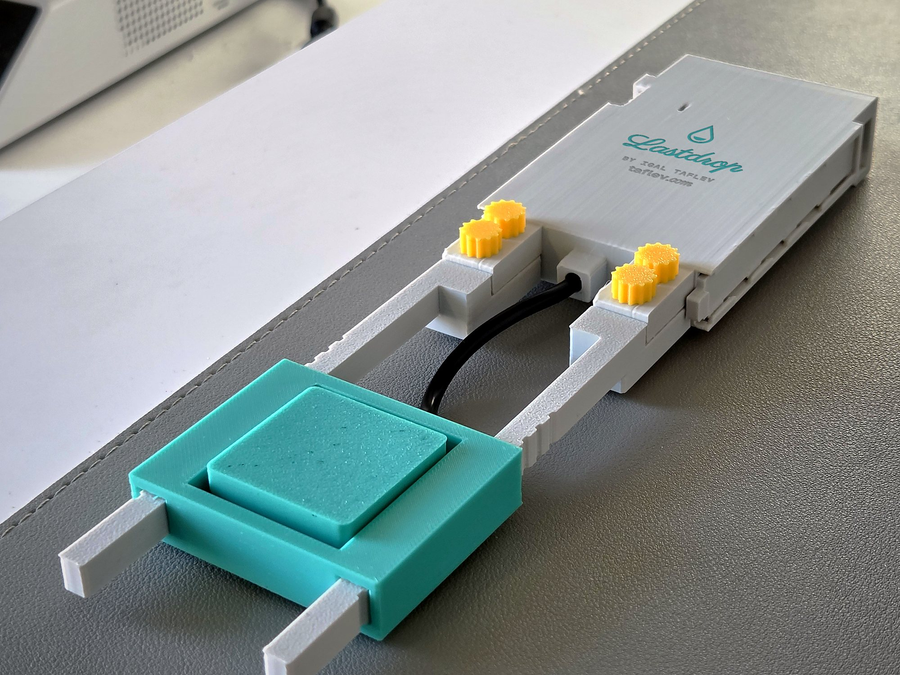
</p>

<p align="center">
  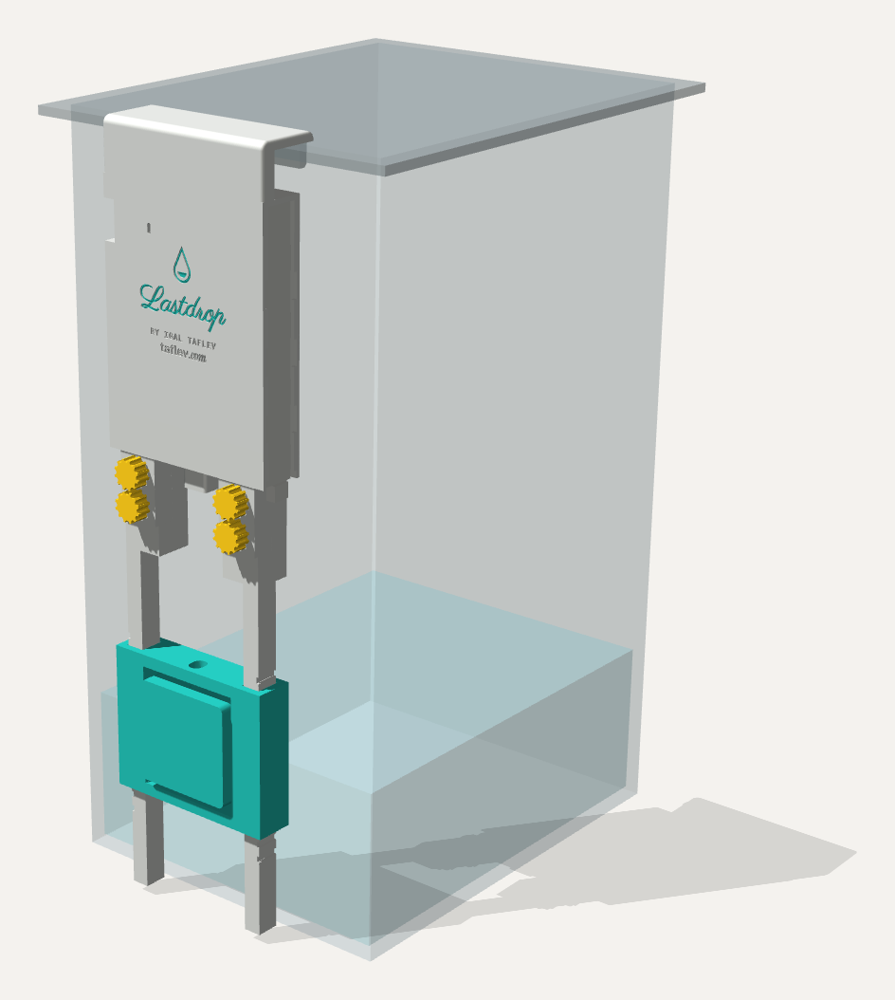
  &nbsp;&nbsp;
  
</p>

---

## Why

Many espresso machines stop only when the tank is already empty, mid-shot. Lastdrop warns you while there are still
2 to 3 shots left, in three ways:

- the LED on the device turns from **green** to **pulsing red**;
- a **spoken announcement** on a speaker in the house;
- a **push notification** on your phone.

It was built for an **ECM Classika PID**, but it works on any machine with a plastic or glass tank you can reach from the outside.
The housing is parametric, so it can be adapted to another tank (see [Fit it to your tank](#fit-it-to-your-tank)).

## How it works

<p align="center">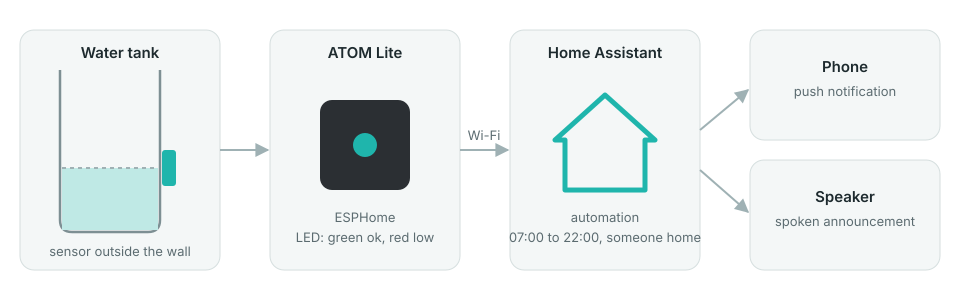</p>

1. An **XKC-Y25-NPN** capacitive sensor sits flat against the outside of the tank wall. It feels the water through the
   plastic, with no contact with the water.
2. An **M5Stack ATOM Lite** (ESP32) reads it on its Grove port and runs **ESPHome**. Its built-in LED shows the state.
3. **Home Assistant** gets the state over Wi-Fi and runs the automation: notification and announcement, only during the
   day and only when someone is home. It fires again if the machine is switched on while the tank is still low.

## Parts

| Part | Qty | Notes | Link |
|---|---|---|---|
| M5Stack ATOM Lite (ESP32) | 1 | controller, LED, button, Grove port | [M5Stack shop](https://shop.m5stack.com/products/atom-lite-esp32-development-kit) · [docs](https://docs.m5stack.com/en/core/ATOM%20Lite) |
| M5Stack Grove2Dupont cable, 20 cm | 1 | Grove plug to loose wires | [M5Stack shop](https://shop.m5stack.com/products/grove2dupont-conversion-cable-20cm-5pairs) · [docs](https://docs.m5stack.com/en/accessory/cable/grove2dupont) |
| XKC-Y25-NPN liquid level sensor, 5 to 12 V | 1 (a spare is handy) | non-contact, NPN output | [Keyestudio](https://keyestudio.com/products/xkc-y25-5-12v-npn-output-interface-non-contact-adjustable-water-level-sensor) · [AliExpress search](https://www.aliexpress.com/w/wholesale-XKC%2DY25%2DNPN.html) |
| WAGO 221-412 lever connector | 3 | joins the sensor wires to the Grove wires | [WAGO](https://www.wago.com/ca-en/installation-terminal-blocks-and-connectors/compact-splicing-connector/p/221-412) |
| USB-C cable + 5 V USB power supply | 1 | powers the ATOM | any |
| PETG, light grey | about 110 g | frame, rails, lid, door; heat-safe next to the machine | [Bambu Lab PETG HF](https://us.store.bambulab.com/products/petg-hf) |
| PETG, turquoise | about 45 g | slider, sensor head, logo and name | [Bambu Lab PETG HF](https://us.store.bambulab.com/products/petg-hf) |
| PETG, yellow | about 3 g | the four thumb screws | [Bambu Lab PETG HF](https://us.store.bambulab.com/products/petg-hf) |

No glue and no bought screws: the four thumb screws are printed.

## Wiring

<p align="center">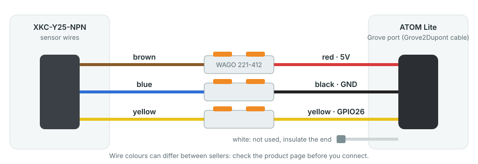</p>

| Sensor wire | Grove wire | ATOM Lite |
|---|---|---|
| brown | red | 5 V |
| blue | black | GND |
| yellow | yellow | GPIO26 (signal) |
| | white | not used: insulate the end |

Cut the Dupont ends off and join each pair in a WAGO 221-412. The three WAGOs ride in their own tracks inside the housing.
Wire colours sometimes differ between sellers, so check the product page first.

## Firmware (ESPHome)

The config is in [`firmware/lastdrop.yaml`](firmware/lastdrop.yaml).

1. Copy [`firmware/secrets.yaml.example`](firmware/secrets.yaml.example) to `secrets.yaml` next to it, in your ESPHome
   config folder, and fill in your Wi-Fi, an API key, an OTA password and a password for the fallback hotspot (used only when
   the device cannot reach your Wi-Fi). Never commit `secrets.yaml`.
2. Flash it once over USB from the ESPHome dashboard. Later updates go over Wi-Fi.
3. Home Assistant finds the new device. Adopt it.

What the device gives Home Assistant:

- `binary_sensor.lastdrop_water_ok`: on while there is water at the sensor height;
- `light.lastdrop_status_led`: the LED (green at 15 % when OK, pulsing red at 60 % when low);
- `binary_sensor.lastdrop_button`: the ATOM's button, free for your own automations.

The signal is filtered: it must be wet for 2 s to count as OK and dry for 10 s to count as low, so sloshing does not
trigger it. If the LED is green with an empty tank, change `inverted: true` to `false` on GPIO26.

## Home Assistant

The automation is in
[`home-assistant/lastdrop-low-water-automation.yaml`](home-assistant/lastdrop-low-water-automation.yaml).
Paste it as a new automation in YAML mode and change the lines marked `CHANGE`: your phone, your text-to-speech engine,
your speaker, and optionally the smart plug of the machine.

It fires:

- when the level drops (after 10 s low);
- when the machine is switched on while the tank is still low (smart plug only);
- between 07:00 and 22:00, and only when someone is home.

## The housing

<p align="center">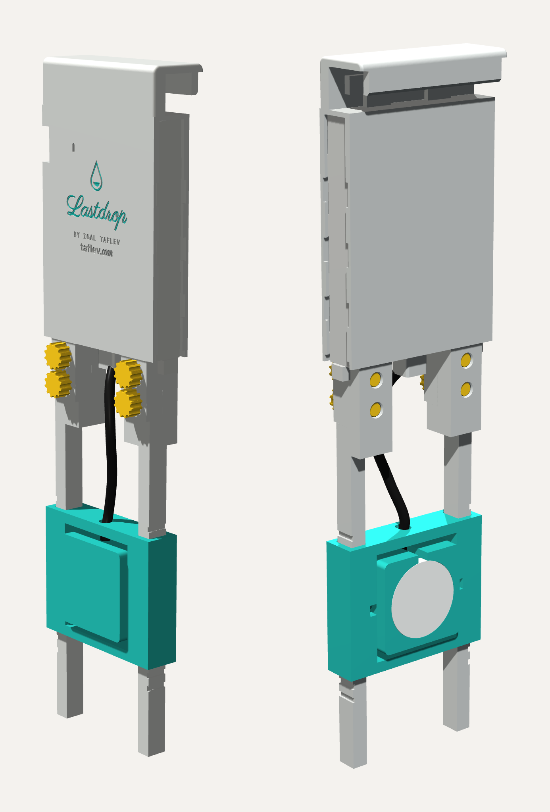</p>

<p align="center">
  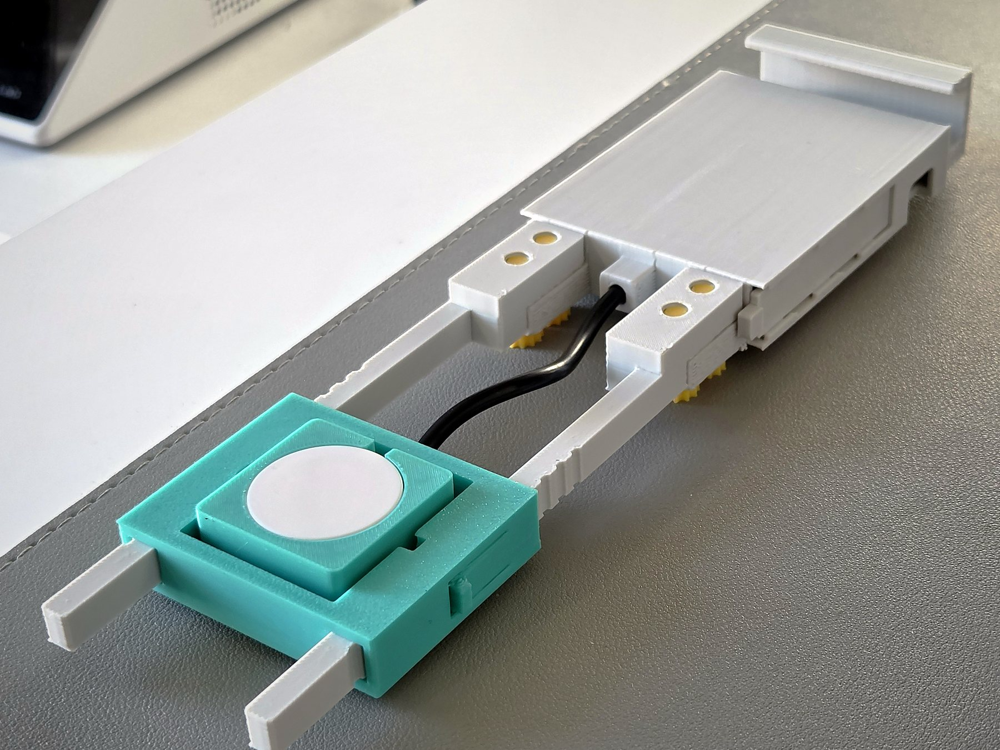
  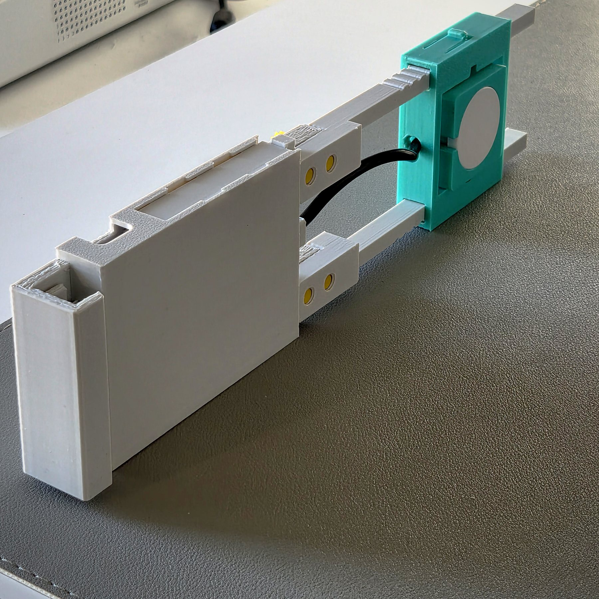
</p>

Everything hangs on the rim of the original tank. Nothing is stuck to the machine.

- **Top frame**: a hook over the tank rim with a lip that goes into the tank, two snap fingers with release tabs, and a box
  that holds the ATOM, the three WAGOs and the spare cable. The ATOM sits below the rim height so the cup tray still closes.
  Its LED shines through a slot in the engraved face.
- **Lid** (machine front) and **door** (USB side): slide down 8 mm past a click, then lift off. No screwdriver.
- **ATOM key**: a spacer behind the ATOM, so pushing in the USB plug does not move the board.
- **Lower rails**: two rails with a notch every 5 mm, joined to the frame with four printed M6 thumb screws.
- **Carriage**: slides on the rails and clicks into the notches, to set the sensor height (30 to 90 mm from the tank
  bottom, in 13 steps). Closed cable ring at the top.
- **Sensor head**: holds the sensor with its wide face flat against the tank, and tilts ±10° so it sits flush by itself.

### Print files

All files are for a **Bambu Lab A1 mini**, **PETG**, already oriented. They open in Bambu Studio with the settings inside.

**[`lastdrop_housing_A1mini_PETG_AMS_4plates.3mf`](3d/housing/print/lastdrop_housing_A1mini_PETG_AMS_4plates.3mf)**
is the whole housing in one file. Load the AMS lite with **grey in slot 1, turquoise in slot 2, yellow in slot 3**.

| Plate | Parts | Colour | Time |
|---|---|---|---|
| 1 | sensor head + slider (print this first: it tests the fits) | turquoise | about 1 h 10 |
| 2 | 4 thumb screws | yellow | about 25 min |
| 3 | rails, lid, door, ATOM key | grey | about 1 h 20 |
| 4 | top frame with the logo | grey + turquoise | about 7 h 40 |

Plates 1 to 3 use one colour each, so they print without colour changes; without an AMS, just load that spool.
On plate 4 the logo and the name change colour on every layer that has them. Without an AMS, set the logo part to
grey and it prints in about 2 h 20 with the same engraving.

Also here: [`lastdrop_top_frame_colour_A1mini_PETG_AMS.3mf`](3d/housing/print/lastdrop_top_frame_colour_A1mini_PETG_AMS.3mf)
(plate 4 on its own) and [every part as an STL](3d/housing/print), oriented for printing, for any slicer.

| STL | Qty |
|---|---|
| `top_frame.stl` | 1 |
| `lid.stl` | 1 |
| `door.stl` | 1 |
| `atom_key.stl` | 1 |
| `lower_rails.stl` | 1 (both rails) |
| `carriage.stl` | 1 |
| `sensor_head.stl` | 1 |
| `screw.stl` | 4 |

### Print settings

| Setting | Value |
|---|---|
| Material | PETG (heat next to the boiler: PLA can creep) |
| Nozzle / layer | 0.4 mm / 0.2 mm |
| Walls | 3 |
| Top / bottom shells | 5 / 5 |
| Infill | 25 % gyroid |
| Supports | tree (auto), from the build plate only |
| Plate | Textured PEI |

### Printing tips

- **Print a test first.** Plate 1 is the sensor head and the slider. It is small and tells you quickly whether the fits
  are right on your printer.
- **Cable holes are 4.6 mm** for a 3.7 mm sensor cable. 4.0 and 4.5 mm printed too tight.
- **The threads are printed** (M6 in the rails, printed thumb screws). The rails are printed with the hole axis vertical
  so the threads come out round. Turn the screws in gently the first time.
- **The top frame prints with the LED face standing up**, so that the box walls stand and need almost no supports.
  The price is a colour change on every layer with logo: about 7 h 40 instead of 2 h 20 in one colour. The purge goes
  into the hidden infill to save filament.
- **Small text:** every engraved stroke is at least 0.5 to 0.6 mm wide, so a 0.4 mm nozzle can draw it. If you change
  the text, keep it that way (`NAME_GROW` and `BYLINE_GROW` in `build.py`).

<p align="center">
  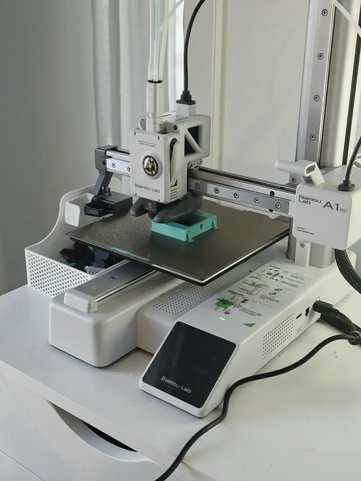
  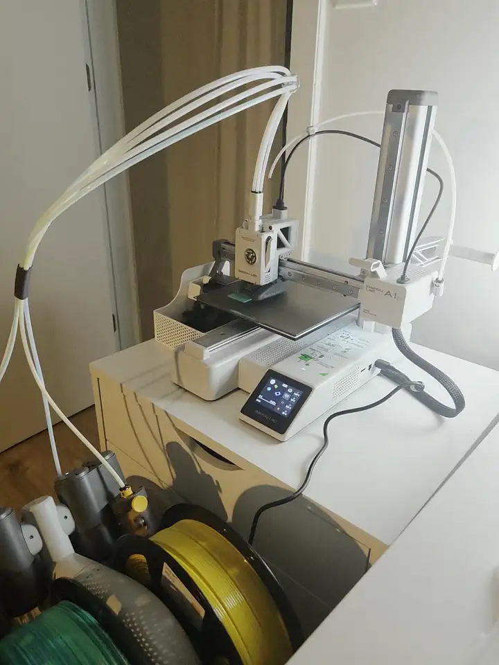
</p>
<p align="center">
  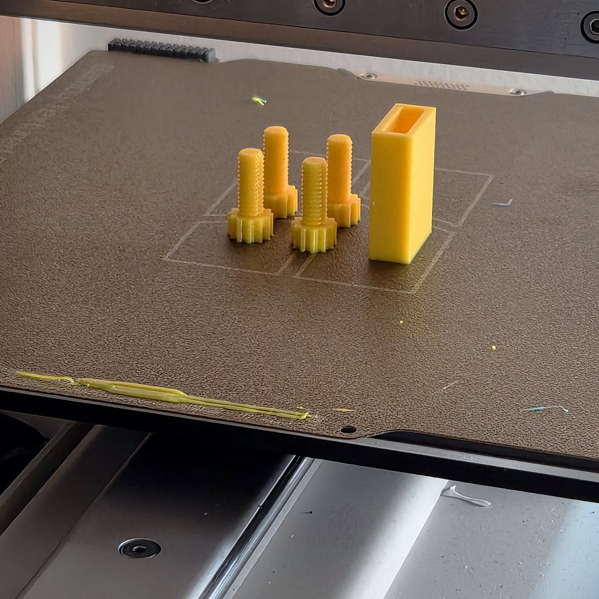
  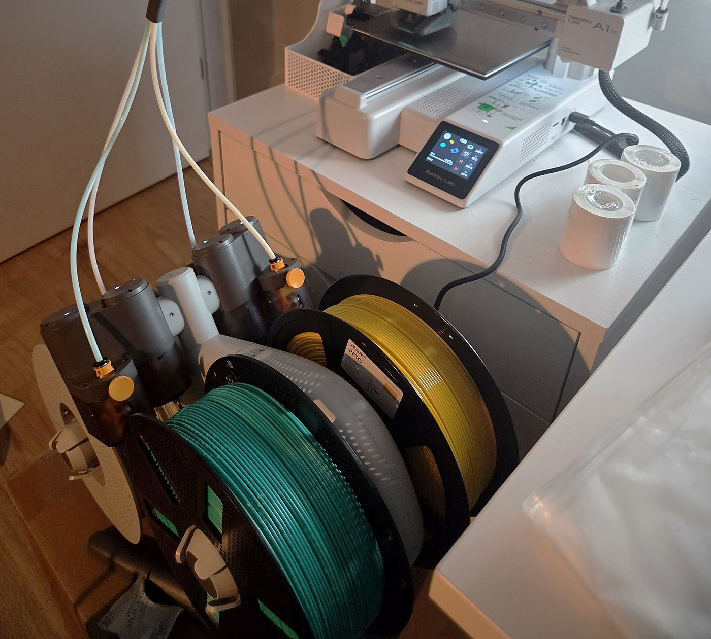
</p>
<p align="center"><sub>Full-quality clips: <a href="docs/clips/printing-slider.mp4">printing-slider.mp4</a> ·
<a href="docs/clips/ams-printing.mp4">ams-printing.mp4</a></sub></p>

## Assembly

1. Push the sensor into the sensor head from the front, narrow end first. The wide face ends flush with the front.
2. Thread the sensor cable up through the carriage cable ring and into the floor hole of the top frame.
3. Join the wires in the three WAGOs (see [Wiring](#wiring)) and press each WAGO into its track, wire entries toward the door.
4. Plug the Grove cable into the ATOM, put the ATOM in at the top with its LED behind the slot, and put the ATOM key behind it.
5. Screw the lower rails to the frame with the four thumb screws. Slide the carriage onto the rails and click it in
   at the height you want. Clip the sensor head onto the carriage.
6. Slide the lid and the door on.
7. Hang the frame on the narrow end of the tank, then plug in the USB-C cable through the door side.

<p align="center">
  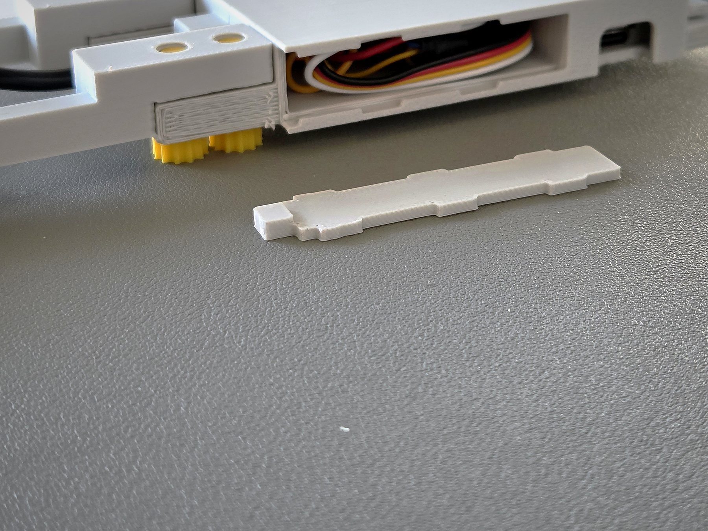
  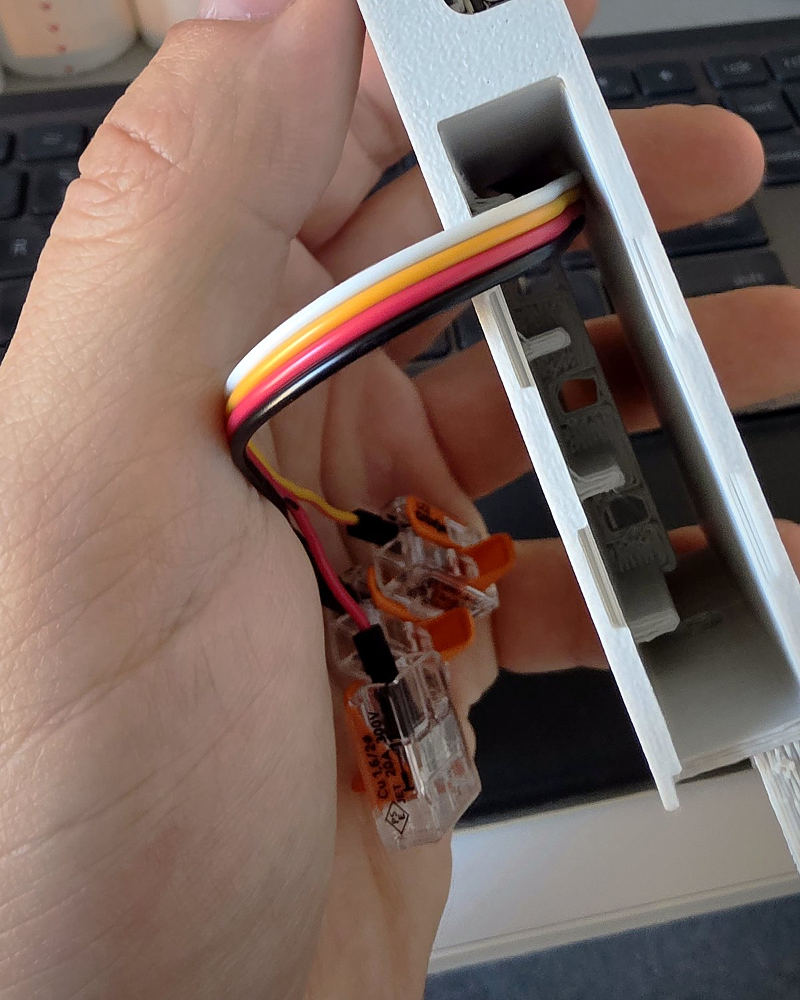
</p>
<p align="center">
  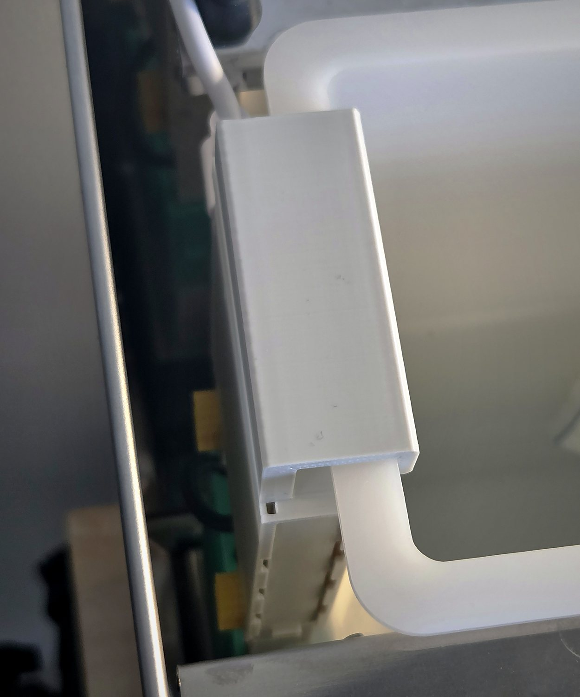
  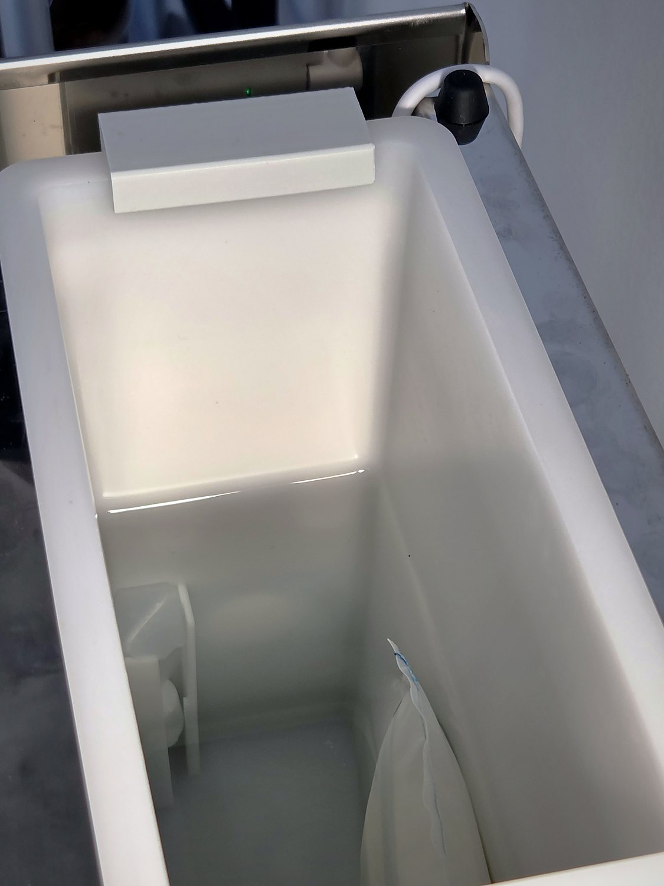
</p>

**Setting the height:** the alert fires when the water drops below the sensor. Set it a little above the level at which
the machine stops, so you keep 2 to 3 shots of warning.

## Fit it to your tank

The housing is a parametric [CadQuery](https://cadquery.readthedocs.io) model:
[`3d/housing/build.py`](3d/housing/build.py). Every size is a named constant at the top. The values for the
ECM Classika PID tank:

| Tank measurement | Value |
|---|---|
| Rim flange sticks out / thickness | 7.23 mm / 3.0 mm |
| Tank wall | 3 mm |
| Room above the rim to the cup tray | 6.95 mm |
| Gap between the tank and the machine wall | about 33.8 mm |
| Tank height to the rim | 250 mm |

Measure yours with a caliper, change the constants, and rebuild:

```bash
cd 3d
python -m venv .venv
.venv/bin/pip install cadquery trimesh manifold3d numpy shapely fonttools networkx lxml
cd housing
./run_all.sh            # model -> threads -> print orientation -> Bambu 3MF files
python verify_all.py    # 31 geometric checks: fits, cable paths, lid and door, USB plug; all must pass
python check_install.py # hangs the frame on the rim and checks the path
```

(On Windows, use `.venv\Scripts\python` instead of `python`.)

`branding.py` draws the engraving from the font files: the drop logo, the name in Parisienne and the small text,
each outline grown so it is printable. The fonts and their licenses are in [`3d/fonts`](3d/fonts).

## Repository layout

```
firmware/          ESPHome config + secrets example
home-assistant/    the low-water automation
3d/housing/        CadQuery model, print pipeline, checks
3d/housing/print/  ready-to-print STL and Bambu Studio 3MF files
3d/fonts/          fonts used for the engraving (SIL OFL)
docs/images/       logo, diagrams and renders
docs/photos/       photos of the printed housing
docs/clips/        short printing clips (WebP for the page, MP4 full quality)
```

## Photos and videos

Photos of the real thing are in [`docs/photos`](docs/photos), printing clips in [`docs/clips`](docs/clips).
They show the first full print, made before the logo was added to the model; on the top photo the engraving was
laid onto that print to show the finished look.

---

<p align="center">
  Designed by Igal Taflev · <a href="https://taflev.com">taflev.com</a>
</p>
