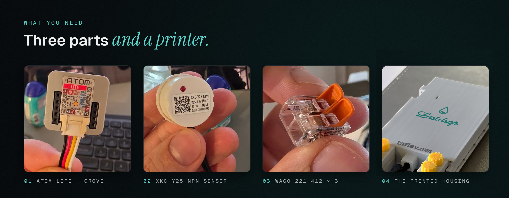
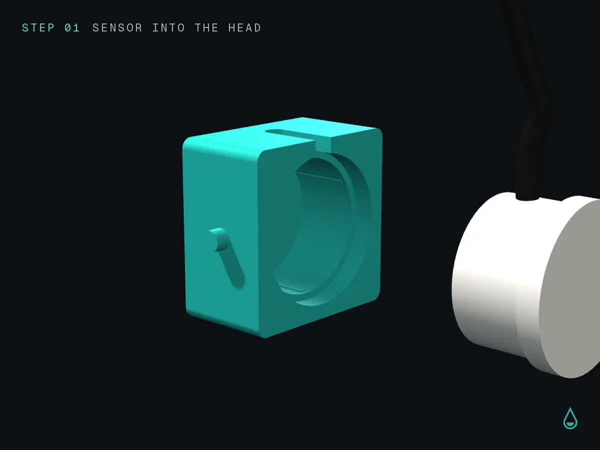
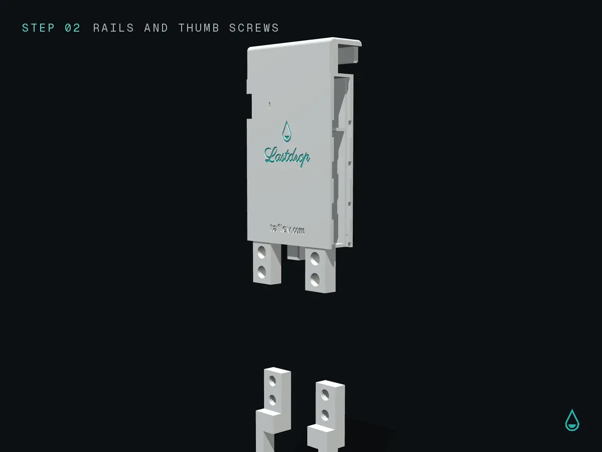
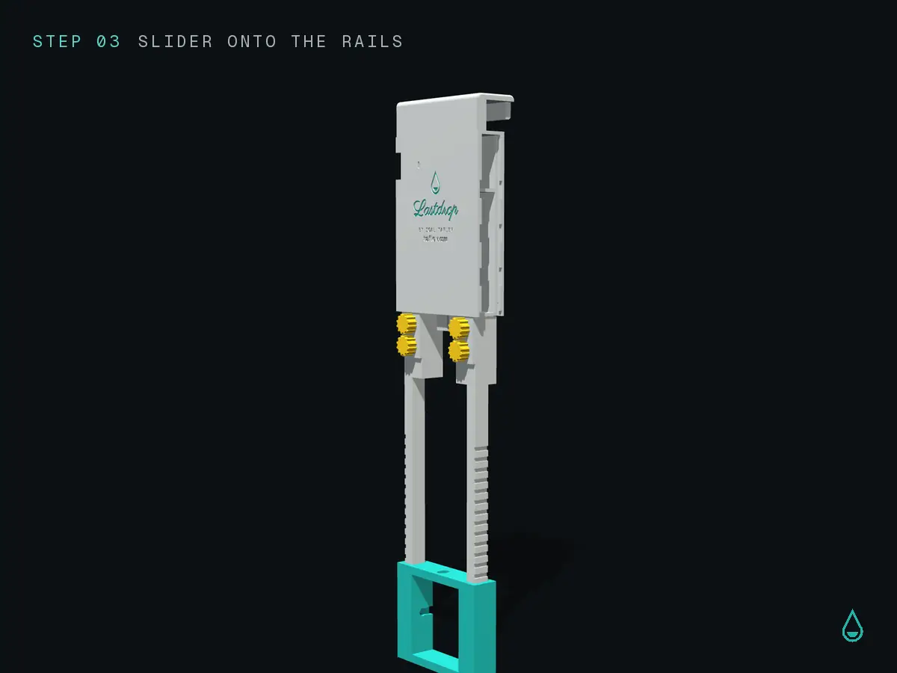
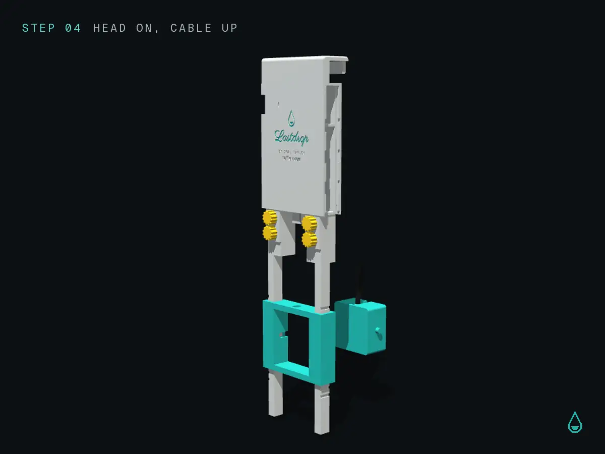
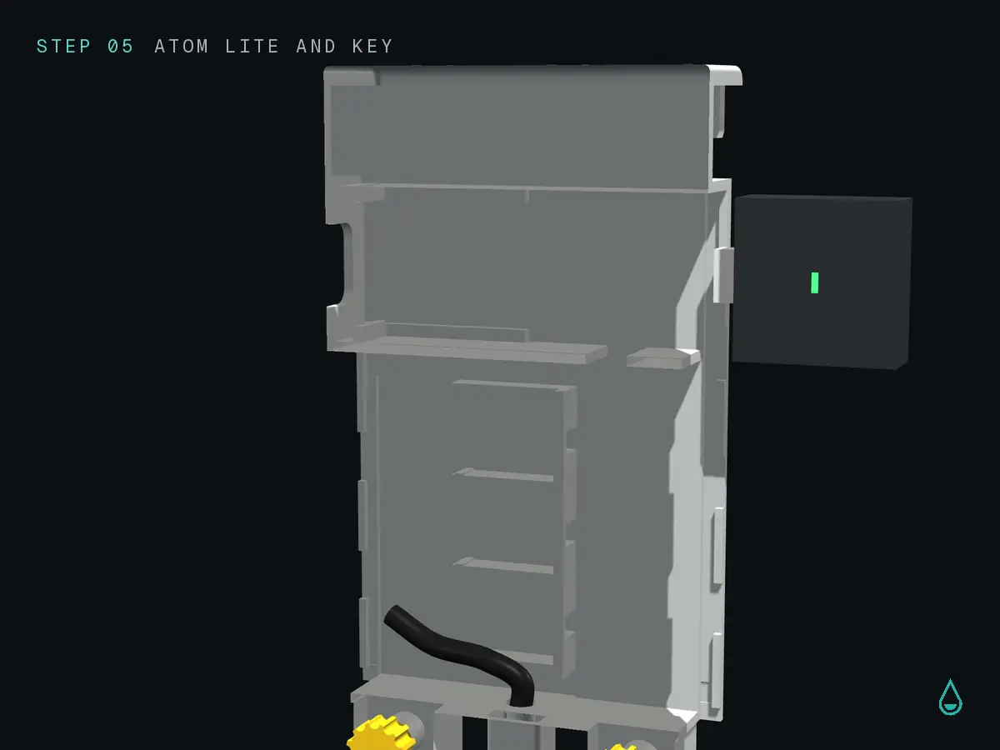
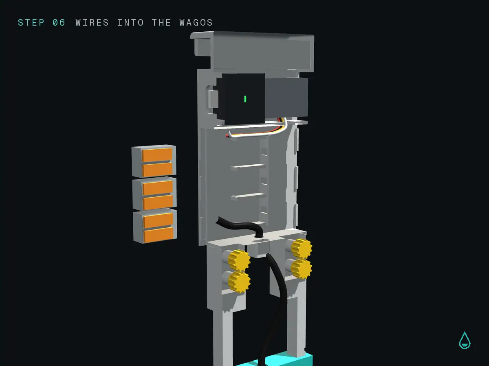
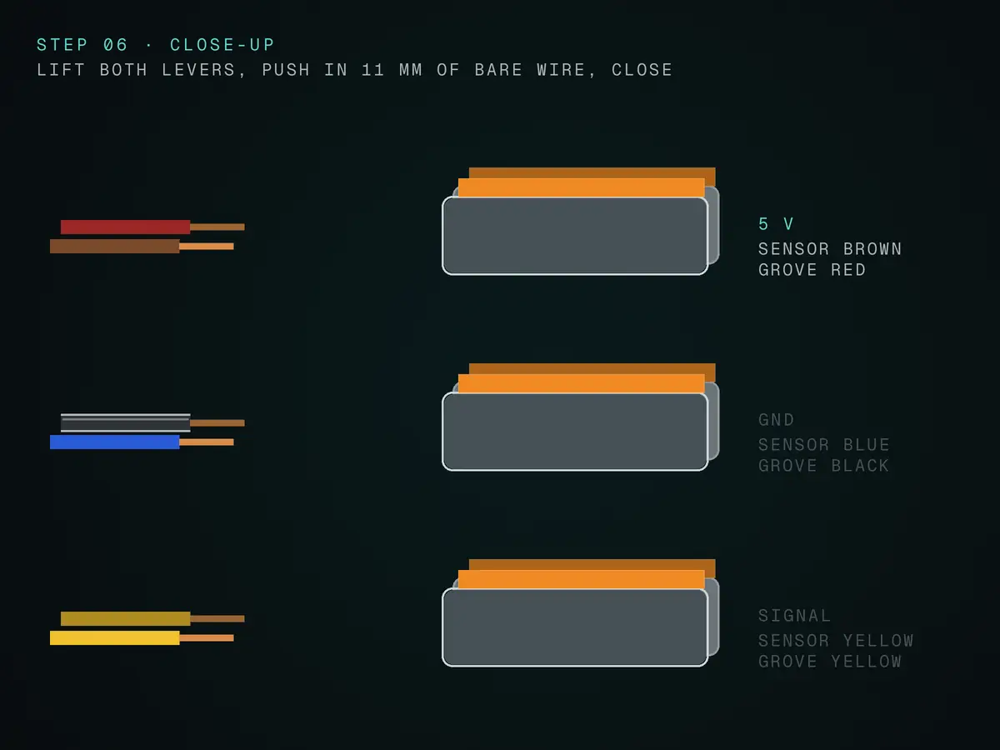
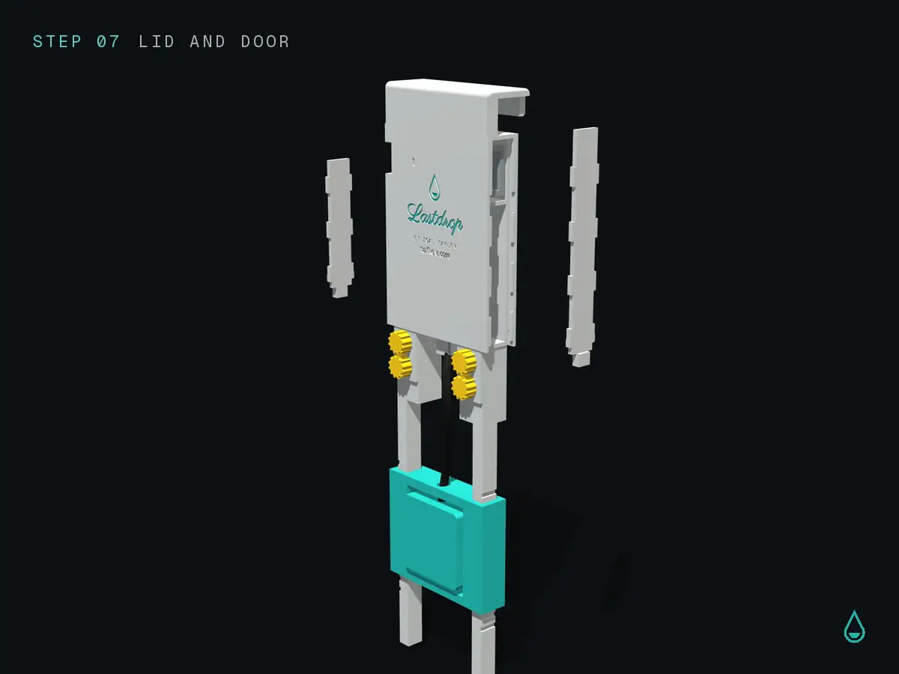
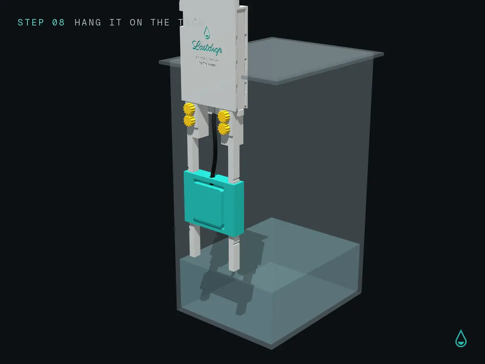

# Assembly guide

Every step of building Lastdrop, from loose parts to the tank. The animations come from the same CadQuery model the
parts are printed from, so every part ends exactly where it belongs. Allow about 30 minutes.

[← Back to the README](../README.md)

## Before you start

**Parts**

- M5Stack ATOM Lite and a Grove2Dupont cable ([M5Stack](https://shop.m5stack.com/products/atom-lite-esp32-development-kit), [cable](https://shop.m5stack.com/products/grove2dupont-conversion-cable-20cm-5pairs))
- XKC-Y25-NPN level sensor, 5 to 12 V ([Keyestudio](https://keyestudio.com/products/xkc-y25-5-12v-npn-output-interface-non-contact-adjustable-water-level-sensor))
- 3 × WAGO 221-412 ([WAGO](https://www.wago.com/ca-en/installation-terminal-blocks-and-connectors/compact-splicing-connector/p/221-412))
- The printed parts: top frame, lid, door, ATOM key, two rails, slider, sensor head, four thumb screws
  ([how to print them](../README.md#5-print))
- **A USB-C cable long enough to leave the machine, and a 5 V USB power supply** (1 A is plenty). The cable runs from the
  ATOM, out of the back of the machine, to a wall socket. Lastdrop has no battery: without power, there is no alert.

**Tools**

- **Wire stripper for thin wire.** The Grove wires are 26 AWG, thinner than most strippers handle.
  [Klein Tools 11057](https://www.kleintools.com/product/11057) (20 to 30 AWG, about $25) is made for exactly this.
  If you want one stripper for everything, the self-adjusting
  [Knipex MultiStrip 10, 12 42 195](https://www.knipex-tools.com/products/wire-strippers-and-dismantling-tools/automatic-wire-strippers/automatic-wire-stripper-mm2/1242195)
  goes down to 32 AWG.
- **Flush cutter** to cut off the Dupont plugs and clean up print edges, such as the
  [Hakko CHP-170](https://pololu.com/product/2791).
- A bit of electrical tape or a short piece of heat-shrink tubing for the unused white wire.
- No screwdriver, no glue, no soldering iron.

## 1. Sensor into the head

Push the sensor into the head from the front (the tank side), **narrow end first**, until the wide face is flush with
the front. The wide face is the sensing face: it must end up flat against the tank. The three crush ribs hold it; a firm
push is normal. Lead the cable into the slot at the top of the head.

## 2. Rails and thumb screws

Set the two rails against the joint stubs under the box, notches facing out, and turn in the four yellow thumb screws.
The threads are printed: turn gently the first time, and stop when the rails no longer wobble.

## 3. Slider onto the rails

Slide the turquoise slider onto the rails from below and push it up until it clicks into a notch. Each notch is 5 mm;
the range is 30 to 90 mm above the tank bottom. Set it a little above the level at which your machine stops. You can
change it later without taking anything apart.

## 4. Head on, cable up

Clip the head onto the slider from the tank side: the pegs slide in, over the ramp, and click into their seats. The head
tilts a little, so it can sit flat against the tank. Then run the black cable up through the **closed ring in the
slider's upper bridge** and into the **floor hole of the box**. Leave a loose curve between the ring and the box, so the
slider can still move.

## 5. ATOM Lite and key

*The LED face is cut away here to show the inside.*

Plug the Grove cable into the ATOM first. Then set the ATOM at the top of the box from the open front: **USB-C port
toward the door side**, LED toward the engraved face so it shines through the slot. The Grove wires leave the plug
sideways: lead them into the narrow gap on the tank side, along it toward the lid, and down through the shelf opening
**under the ATOM key**. From there they run back over the top WAGO track to the wire room by the door, where they split
to the WAGOs in the next step. Slide the grey ATOM key in behind the ATOM: it stops the ATOM from moving when you push
the USB plug in.

## 6. Wires into the WAGOs

Cut the Dupont plugs off the Grove cable, then strip **11 mm** from each wire. Twist the thin Grove strands tight
before they go in. Join each pair in one WAGO:

- **5 V:** sensor brown with Grove red
- **GND:** sensor blue with Grove black
- **Signal:** sensor yellow with Grove yellow (GPIO26)
- **Grove white is not used.** Cut it short and cover the end with tape or heat-shrink.

Lift the lever, push the bare end in until it stops, close the lever, and **tug each wire** gently: it must not move.
Wire colours vary between sellers, so check yours against the product page. Then push each WAGO into its track **from
the door side, closed end first**, until it clicks past the bumps and stops at the inner wall; the wire entries face the
door. Tuck the spare wire into the storage space between the WAGOs and the door.

## 7. Lid and door

Slide the lid onto the front side (toward the front of the machine) and push it down 8 mm until it clicks. The door goes
on the back side the same way, under the USB window. Both lift off again after an 8 mm slide up, with no tools.

## 8. Hang it on the tank

Hang the frame on the rim at the **left narrow end of the tank**, with the sensor face against the tank wall. Plug the
USB-C cable into the ATOM through the window above the door, **lead it out of the back of the machine, and plug it into
the 5 V supply**. Put the tank back.

The LED shows the state: green means water above the sensor. Pour water out until the level drops below the sensor and
the LED turns to a pulsing red within about 10 s. If it does the opposite, set `inverted: false` in the firmware (see the
[README](../README.md#3-firmware)).

## If something is off

- **No LED at all:** check the USB supply and that the plug is fully in; the ATOM key behind it should keep it from moving.
- **Always "low":** the sensor face is not flat on the tank, or a wire is loose in a WAGO. Tug each one.
- **The head does not click:** push the pegs straight in from the tank side; the first click is the firmest.
- **The slider moves on its own:** it is between notches. Push it until it clicks.

[← Back to the README](../README.md)
